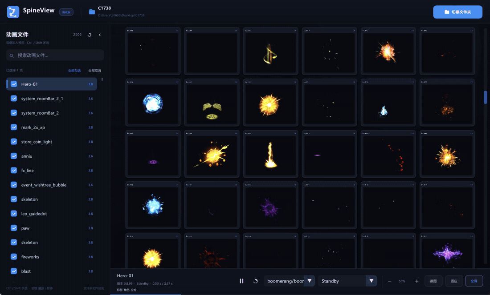
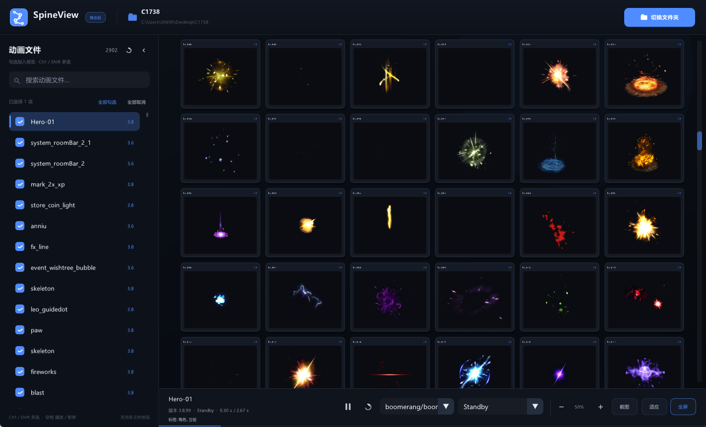
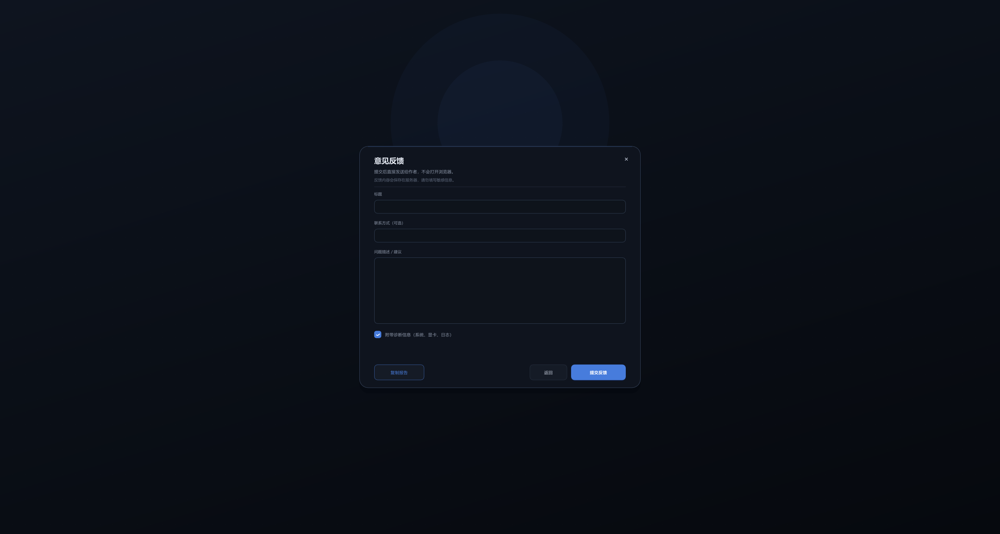

# SpineView

**轻量、专注的动画查看器**：在一个窗口里同时预览多个动画文件，全屏按原始尺寸查看，支持标签、搜索、批量切换动画与皮肤，以及一键截图。

Windows 10 / 11 x64 · 免安装 · 手机号登录，首次登录免费试用一个月

**下载：** [打开 Releases 页面](https://github.com/qq5069099/SpineView/releases)（新手请见下方「如何下载」）

[下载与安装](#下载与安装) · [快速上手](#快速上手) · [功能一览](#功能一览) · [操作速查](#操作速查) · [购买与激活](#购买与激活) · [常见问题](#常见问题)

## 下载与安装

安装包发布在本仓库的 [Releases](https://github.com/qq5069099/SpineView/releases) 页面，按渠道提供安装包；通过购买渠道购买的用户，也可以使用渠道提供的安装包。

### 如何下载（新手请看这里）

1. 打开本仓库的 [Releases 页面](https://github.com/qq5069099/SpineView/releases)。如果当前在仓库首页，也可以点击页面右侧的「Releases」。
2. 在最新版本（页面最上面）下方找到「Assets」；如果没有看到文件列表，点击「Assets」展开。
3. 下载页面上提供的 zip（文件名形如 `<渠道>-SpineView-<版本>.zip`），以及同名的 `.sha256` 校验文件；如果页面有多个渠道包，请选择与你购买渠道对应的一个。
4. **不要下载 `Source code (zip)` 或 `Source code (tar.gz)`**，它们不是安装包。
5. 解压到任意目录（路径可以包含中文），双击 `SpineView.exe` 启动。
6. 输入手机号并获取短信验证码，登录后即可使用；每个手机号从首次登录起有一个月试用期。

不确定该下载哪个文件时，请联系购买渠道或技术支持。

**免安装**：不需要安装其他组件，删除整个文件夹即可卸载。

**系统要求**：Windows 10 / 11 x64（推荐）。Windows 7 SP1 / 8.1 x64 需要系统支持 TLS 1.2 与相应根证书；建议使用仍受微软支持的 Windows 版本。

> 请只从本仓库 Releases 或购买渠道获取安装包。下载后可用 `certutil -hashfile <安装包> SHA256` 与 `.sha256` 文件核对，确认文件完整。

## 快速上手

1. **选择项目**：启动后先在起始页选择最近打开的项目，或把包含动画文件的文件夹直接拖进窗口，也可以点击「打开文件夹」。
2. **预览文件**：打开文件夹后会默认勾选全部可预览文件，右侧画布实时播放整个目录的卡片；取消不需要的文件即可，也可以多选并排预览。
3. **进入全屏**：双击卡片进入全屏，按 `Esc` 返回。

程序不会自动打开上次的项目，每次都由你明确选择。没有任何勾选时，画布保持为空并显示常用操作提示。工作区右上角的「切换文件夹」会返回起始页；点击顶栏的文件夹名称，可以在文件管理器中打开当前动画文件夹。

## 功能一览

### 多文件同屏

- 一个窗口同时预览多个动画文件，自动排布成卡片网格。
- 网格列数随窗口宽度和当前缩放动态计算；勾选很多文件时会自动适应，最低保持约 40% 的卡片大小，不会缩成不可读的小点。
- 自动选择内容最完整的画面作为预览。
- 卡片超过一屏时，画布右侧出现垂直滚动条；拖动卡片、空白处或中键拖动即可滚动，松手后带惯性。画布水平锁定，只做垂直滚动。
- 左侧文件列表可以收起成一竖条，把更多面积留给画布。

### 全屏查看

双击卡片（或选中后按 `Enter`）进入全屏。全屏默认以 **100% 原始尺寸**显示，不会为了铺满屏幕而强制拉伸；随时可以按 `F` 让动画适应当前窗口。

- 双击卡片 → 全屏 100%
- `F` → 适应窗口（保留原始比例）
- 滚轮 → 以鼠标为中心缩放
- 拖动 → 平移
- `空格` → 播放 / 暂停
- `Esc` → 返回工作区

### 标签库与筛选

给卡片设置标签都在**顶栏标签区**和**标签库管理**里完成：

- 顶栏中间显示当前所选卡片的标签。点击已添加的标签即可从卡片移除，但不会删除标签库里的标签；右侧最多显示 4 个浅色建议标签，点击即可添加到所选卡片。放不下的标签点击末端的「...」打开标签库管理，点击标签名即可加入或移除；先 `Ctrl` / `Shift` 多选卡片，再点标签即可一次应用到多张卡片。
- 标签库支持新建、改名、删除，可用中文逗号、英文逗号或分号一次添加多个。删除前会确认，并同时从标签库、所有卡片和相关筛选中移除。
- 标签库底部支持「复制」全部标签（一行一个复制到剪贴板）和「粘贴」批量添加标签（一行一个，或用逗号、分号分隔）；粘贴只扩充标签库，不会自动加到卡片上。
- 标签库是项目级的：暂时没有用在任何卡片上的标签也会保留，并随项目保存。
- 顶栏「筛选」可以多选标签，左侧文件列表和画布只显示同时包含所有选中标签的文件/卡片；再次点击已选标签或「清除筛选」即可取消。筛选区显示最多 8 个常用标签，其余在弹窗中选择。筛选只在本次打开期间有效。
- 选中筛选标签时，左侧列表中符合条件但还没有勾选的文件会自动勾选并显示到画布上。未选中文件或只选中一个文件时，列表顶部显示「全部勾选 / 全部取消」；在筛选状态下，它们只作用于当前筛选结果，执行后会清除标签筛选。
- 文件夹或文件名中的 `[xxxx]`（也支持 `【xxxx】`）会自动成为**路径标签**：文件夹标签作用于其下所有文件，文件标签只作用于该文件；一条路径可写多个。路径标签可用于筛选，但不能从卡片移除，也不写入项目文件；与普通标签同名时以路径标签为准。只统计当前项目文件夹及其内部路径，改名或重新扫描后自动更新。
- 标签会以浅色文字显示在卡片标题中，并同时显示在底部检查器中。
- 左侧搜索框只按**文件名**过滤；标签请使用顶栏「筛选」。

### 批量切换动画与皮肤

底部检查器中，皮肤下拉框在左、动画下拉框在右，单选时只列出当前文件可用的动画或皮肤。

先 `Ctrl` / `Shift` 多选卡片，再点击下拉框时，会临时计算并显示所选卡片**共同拥有**的名称；选择后，只有确实拥有该动画或皮肤的那些卡片会切换，其他卡片保持不变。全屏页面只修改正在查看的这一张动画，不做批量修改。

切换过的动画和皮肤会按文件记录到当前项目，下次打开同一目录时自动恢复。

### 截图与复制

底部工具栏的「截图」按钮会按当前选择决定导出内容：

- **未选择卡片**：把画布上所有已勾选卡片（包括需要滚动才能看见的卡片）导出为一张长图，自动保存到当前项目文件夹。卡片较多时会先询问是否继续。
- **选择一张卡片**：等同右键菜单的「图像截图」，把该卡片保存到动画文件所在子文件夹的 `SpineView.jpg`（每次覆盖）。
- **选择多张卡片**：只把所选的这几张卡片导出为一张长图，保存到当前项目文件夹。

截图会逐步生成，期间界面仍可操作并显示进度；完成后右下角滑出「截图成功」提示，显示保存路径，点击其中的「浏览」可在文件管理器中定位到该图片。对于首帧没有图案的动画，会自动选择内容最完整的画面。

右键单张卡片还可以：

- **图像截图**：把当前卡片（含标题、标签和当前动画帧）保存到该动画文件所在子文件夹，每次覆盖同一张图片。
- **图像复制**：把同一张卡片图片复制到 Windows 剪贴板，可直接粘贴到聊天窗口、文档或图片编辑器。
- **浏览所在文件夹… / 复制文件位置 / 重新读取动画**：在文件管理器中定位动画文件、复制完整路径，或重新读取当前动画。

右键文件可以浏览所在文件夹…、复制文件位置或重新读取。

### 项目记忆

- 标签库、每张卡片的标签、卡片大小，以及每张卡片选择的动画与皮肤，都会自动保存到当前项目，下次打开同一个文件夹时恢复，无需手动管理配置文件。
- 勾选状态与标签筛选只在本次打开期间有效，不会保存；每次打开文件夹都会重新默认勾选全部可预览文件。
- 起始页按最近使用顺序保存最近 6 个项目，最新的在前；点击卡片进入，点击卡片右上角的 `×` 可以从历史中移除。

### 其他

- 启动时自动最大化，不保存或恢复上次窗口位置和大小。
- 启动后会在后台检查新版本，下载并校验后提示是否更新，可选择「立即更新」或「下次再问」；更新会保留登录状态、最近项目和设置。
- 客户端启动时会先切换到英文输入模式，避免在搜索框输入时误触发中文候选窗；需要中文时按常规快捷键切回即可。

## 操作速查

| 操作 | 功能 |
| --- | --- |
| 单击文件行 | 选中并在底部检查器查看信息 |
| 单击行首勾选框 | 加入 / 移出画布预览 |
| `Ctrl` / `Shift` + 单击文件行 | 多选文件（批量勾选、取消勾选） |
| `Ctrl` / `Shift` + 单击卡片 | 多选画布卡片；单击空白处取消卡片选择 |
| 双击卡片 / `Enter` | 全屏预览当前卡片 |
| 底部皮肤 / 动画下拉框 | 切换当前卡片的皮肤或动画；多选卡片时批量切换共同拥有的项 |
| `空格` | 播放 / 暂停 |
| `F` | 工作区：适应画布；全屏：适应窗口 |
| `Esc` | 退出全屏 / 清除选择 |
| 滚轮 | 垂直平移画布；全屏中缩放视图 |
| `Ctrl` + 滚轮 | 缩放画布（以鼠标为中心） |
| 垂直拖动卡片 / 空白处 / 中键拖动 | 画布垂直滚动，松手后带惯性；全屏中平移视图 |
| 画布右侧垂直滚动条 | 卡片超过一屏时出现，拖动滑块或点击轨道快速滚动 |
| 侧栏右上角箭头 / 收起后的竖条 | 收起或展开文件列表 |
| 底部「截图」 | 未选择时导出全部已勾选卡片；选中一张时保存该卡片；多选时只导出所选卡片 |
| 右键卡片 | 图像截图、图像复制、重新读取动画、浏览所在文件夹…、复制文件位置 |
| 右键文件 | 浏览所在文件夹…、复制文件位置、重新读取 |
| `Ctrl` + `O` | 选择其他文件夹 |
| 标题栏右键 / `Alt` + `Space` | 系统菜单 → 注册 / 意见反馈 / 关于 SpineView |
| 系统菜单或关于页「意见反馈」 | 填写反馈内容，提交后直接发送给作者并显示成功提示 |
| 顶栏标签区 /「...」 | 添加或移除所选卡片的标签；「...」打开标签库并管理标签 |
| 顶栏「筛选」 | 多选标签同时匹配，筛选文件列表和画布卡片（仅本次打开有效） |
| 顶栏文件夹名称 | 在文件管理器中打开当前动画文件夹 |
| 顶栏「切换文件夹」 | 返回起始页，重新选择项目 |
| 搜索框 | 按文件名过滤文件列表 |
| 起始页最近项目卡片 | 打开项目；点击右上角 `×` 从历史中移除 |

## 购买与激活

SpineView 是付费商业软件，提供**年会员**与**永久激活**两种授权，具体期限、设备数量、更新与支持范围以购买订单为准。

- 每个手机号从首次登录起有一个月试用期，试用结束前客户端会提示购买。
- 试用结束后，请联系购买渠道或管理员获取激活码。
- 拿到激活码后，在客户端标题栏右键（或按 `Alt` + `Space`）打开系统菜单，点击「注册」，输入激活码并点击「激活」即可。激活成功后无需重启，立即继续使用。
- 一个手机号可激活的电脑台数由安装包约定的席位数决定；同一台电脑只占一个设备名额，重新登录、更换渠道包或重新安装都不会重复计数；超出时自动退出一台最久未使用的设备。
- 登录后可以离线使用；连续离线超过授权宽限期（默认 3 天）需要联网重新验证。
- 「关于 SpineView」页面会显示版本、渠道、手机号、会员类型、有效期、设备数量与本机登录状态。
- 关于页左下角的「意见反馈」，以及系统菜单（标题栏右键或按 `Alt` + `Space`）中的「意见反馈...」，都可以填写标题、问题描述和可选联系方式；提交后会直接发送给作者并保存在服务器，页面内显示「反馈已提交」，不会打开浏览器，也不需要 GitHub 账号。可附带版本、系统、显卡和日志路径等诊断信息，不会附带手机号等个人信息。也可以点击「复制报告」把完整内容复制到剪贴板，通过邮箱或 QQ 发送。

> **授权提示**：SpineView 为商业授权软件。年会员在有效期内使用；永久激活按订单约定的版本与更新范围永久使用。**未经授权不得复制、转售、分发或共享安装包、激活码或登录信息**。完整条款见 [LICENSE](LICENSE)。

## 常见问题

**打开文件夹后为什么全部文件都被勾选了？**

每次打开文件夹都会默认勾选全部可预览文件；不需要的文件在左侧取消勾选即可，勾选状态不会保存。

**某些文件无法预览？**

请确认文件完整，并与其配套文件放在同一目录。仍然无法预览时，请联系技术支持。

**动画不动 / 只有部分卡片在动？**

只有已勾选的文件会读取并播放。若底部按钮显示为播放三角形，说明当前是暂停状态，按 `空格` 继续播放。未勾选的文件不会占用预览。

**文件夹里有几百个动画，打开会不会卡？**

不会。打开大文件夹后，可以正常浏览和预览当前可见的内容。

**设置保存在哪里？**

标签库、卡片标签、卡片大小以及每张卡片的动画与皮肤选择会自动保存到当前项目，下次打开同一个文件夹时自动恢复；勾选状态与标签筛选不会保存。无需手动管理配置文件。

**需要安装其他组件吗？**

不需要。解压后直接运行即可。

**截图保存在哪里？**

未选择卡片或选择多张卡片时，长图保存在当前项目文件夹；选择单张卡片时保存在该动画文件所在子文件夹（`SpineView.jpg`，每次覆盖）。

**换电脑了怎么办？**

在授权的设备台数范围内直接登录即可；超出时最久未使用的设备会自动退出。需要重置设备请联系管理员。

## 隐私

- 动画文件只在本机读取和显示，不会上传。
- 登录与心跳只发送设备标识的哈希，用于授权管理和在线设备计数。
- 在线期间会与授权服务保持连接，仅用于在线设备计数和接收服务器消息；离线时不影响正常使用。
- 意见反馈只在你点击提交后发送到授权服务器并保存在服务器数据库，不会上传动画文件，也不会公开发布。
- 服务器推送的简短消息会以模态窗口显示，需要手动关闭。

## 联系与支持

购买 / 续费 / 技术支持：

- 客户端系统菜单或「关于 SpineView」→「意见反馈」（直接发送给作者）
- 邮箱：**admin@ahope.vip**
- QQ：**5069099**

## 许可证

SpineView 采用自定义商业授权协议（SpineView Commercial License Agreement 1.1）。完整条款见 [LICENSE](LICENSE)。
